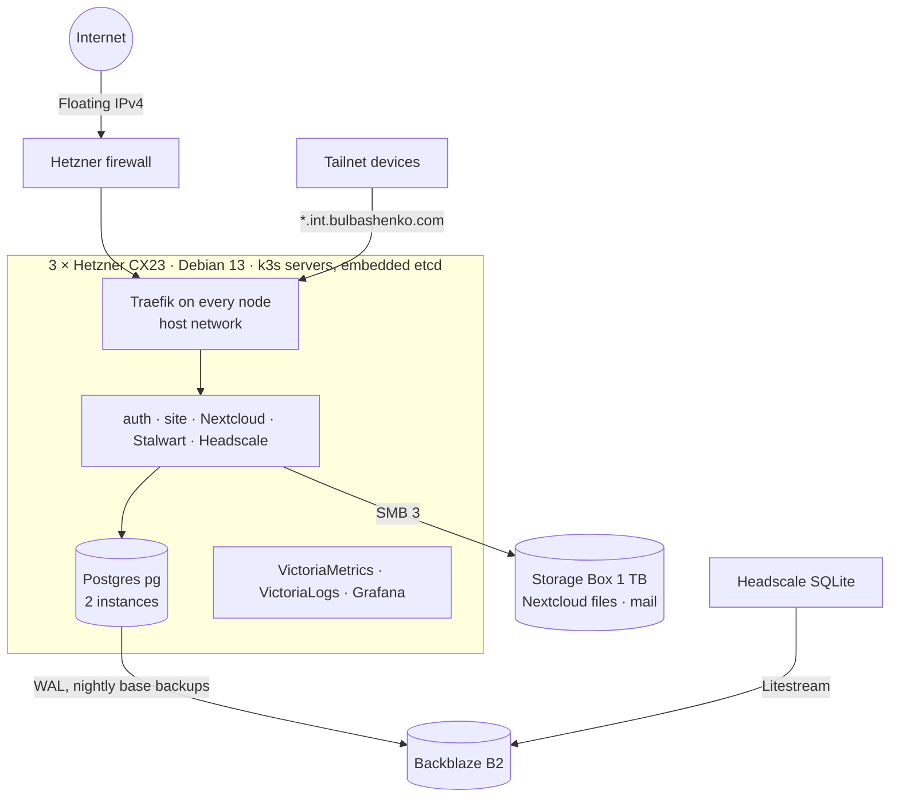

# Architecture

## Shape

- **Nodes.** Three CX23 (2 vCPU, 4 GB, 40 GB) in one location, on three different physical hosts (placement group
  `cluster`, type `spread`). All three are k3s servers (control plane and etcd) and run workloads. Private network `10.0.1.0/24`;
  pod traffic between nodes is encrypted (Flannel `wireguard-native`).
- **Entry.** One Floating IPv4. keepalived on the nodes gives it to a node whose Traefik answers `/ping`, through the
  Hetzner API. Traefik runs on every node on the host network (it sees clients' real addresses) and implements the
  Gateway API: one Gateway `traefik/main`, one Let's Encrypt certificate for `bulbashenko.com`, `*.bulbashenko.com`,
  `*.int.bulbashenko.com`. Mail ports pass through to Stalwart with PROXY protocol. IPv4 only.
- **Admin UIs** live on `*.int.bulbashenko.com`, which resolves to the nodes' tailnet addresses (100.64.0.1–3):
  only devices in the mesh (Headscale) reach them, and Oathkeeper's forward-auth checks the group `infra-admins`
  for UIs without a login of their own.
- **Sign-in** for everything is the SSO at `auth.bulbashenko.com` ([services/auth.md](services/auth.md)).

## Where data lives

No service keeps state on a node: a lost node loses nothing, and every pod can start on another node.

| Data | Where | Protection |
|---|---|---|
| Postgres (auth, site, Nextcloud, Stalwart metadata) | CloudNativePG `pg`, two instances on two nodes, synchronous while both run | WAL + nightly base backups in B2, 14 days, point-in-time recovery |
| Nextcloud files, its `config.php` | Storage Box sub-account `nextcloud` (SMB 3, encrypted) | Storage Box snapshots |
| Mail bodies | Storage Box sub-account `stalwart` | Storage Box snapshots |
| Headscale | SQLite in an emptyDir, streamed by Litestream | B2 (continuous), restored on every start |
| Cluster state | etcd on the three nodes | Snapshots to B2 every 6 hours |
| Metrics and logs | VictoriaMetrics, VictoriaLogs on a node's disk (`local-path`) | None: history only, 14 days |
| Everything else | Git (this org), secrets encrypted with SOPS | GitHub |

## Memory

The previous clusters failed by running out of memory. Here every layer is standard Kubernetes or a standard tool:

1. **kubelet protects the node** (`hosts/cloud-init.yaml`): 1750 MiB reserved for the system and k3s, and pods are
   evicted before the kernel's OOM killer could reach k3s or etcd. The reserve is measured, not GKE's formula (that
   one assumes the control plane runs elsewhere; here every node is a k3s server with etcd): k3s's memory without
   page cache is 1.5–1.65 GB per node, close to the 1606 MB in k3s's own resource profiling. Check it after a k3s
   minor upgrade: `kubectl get --raw /api/v1/nodes/<node>/proxy/stats/summary`, system container `kubelet` (that is
   the whole k3s process). The scheduler and the pods' cgroup (`kubepods`) see only what is left: about 2 GB a node.
2. **zram swap** (half the RAM, zstd) with kubelet's `LimitedSwap`.
3. **VPA** sets every workload's requests from what it really uses, in place where possible, and never touches
   limits. Memory requests follow each pod's typical daily peak (`--target-memory-percentile=0.5`, VPA's default is the
   90th): pods peak at different times, and the sum of every pod's worst peak does not fit the nodes even though their
   real use does. The margin on top is 5 % (default 15 %). A rarer peak is covered by zram and eviction in priority
   order. Goldilocks creates the VPAs for every namespace with `components/defaults`, and shows them at
   `goldilocks.int.bulbashenko.com`. Postgres's pods belong to CloudNativePG, not to a Deployment, so they are not sized
   this way.
4. **LimitRange** in every app namespace: no pod runs without requests.
5. **Priorities.** `tier-1` (auth, site, Postgres, Stalwart, Headscale) stays; `tier-2` (the default: Nextcloud,
   controllers) next; `tier-3` (monitoring) goes first. Its per-node agents (node-exporter, vlagent) are
   `system-node-critical`: they cannot move to another node, so preempting them left a node without metrics and logs.
   The descheduler spreads two-replica apps again once a lost node is back.
6. **Alerts**: the standard kube-prometheus rules (OOM kills, memory pressure, overcommit) reach Telegram.

Watch real usage in Goldilocks and Grafana before adding anything heavy (Matrix is the next candidate).

## High availability

The cluster loses any one node without anyone acting; everything is back in about 1–2 minutes. Two nodes lost
means etcd has no quorum and the cluster waits for one to return: that is the limit of three nodes.

| Part | How | When a node is lost |
|---|---|---|
| Entry | Floating IP + keepalived, Traefik on every node | seconds |
| Control plane | three k3s servers, etcd quorum 2 of 3 | nothing to do |
| Cluster DNS | k3s's CoreDNS, kept at two replicas (`configs/coredns.yaml`) | nothing to do |
| Pods of the lost node | moved after 30 s (`default-*-toleration-seconds`) | ~1–1.5 min |
| Postgres | replica promoted by CloudNativePG; no committed transaction lost | ~30 s |
| auth, site | two replicas on different nodes | nothing to do |
| Stalwart, Headscale, Nextcloud | one replica, nothing on the node | ~1–1.5 min; mail senders retry, the mesh works without Headscale |
| Monitoring | one instance on a node's disk, on purpose | waits for the node; the dead man's switch reports it |
| Maintenance | kured and system-upgrade-controller, one node at a time, with PodDisruptionBudgets | nothing to do |

Outside dependencies: Cloudflare (DNS), the Storage Box (Nextcloud's and the site's files, mail bodies: while it
is unreachable, pages render without media and incoming mail waits at the senders), B2 (backups and Litestream:
while it is unreachable everything runs and catches up later).
